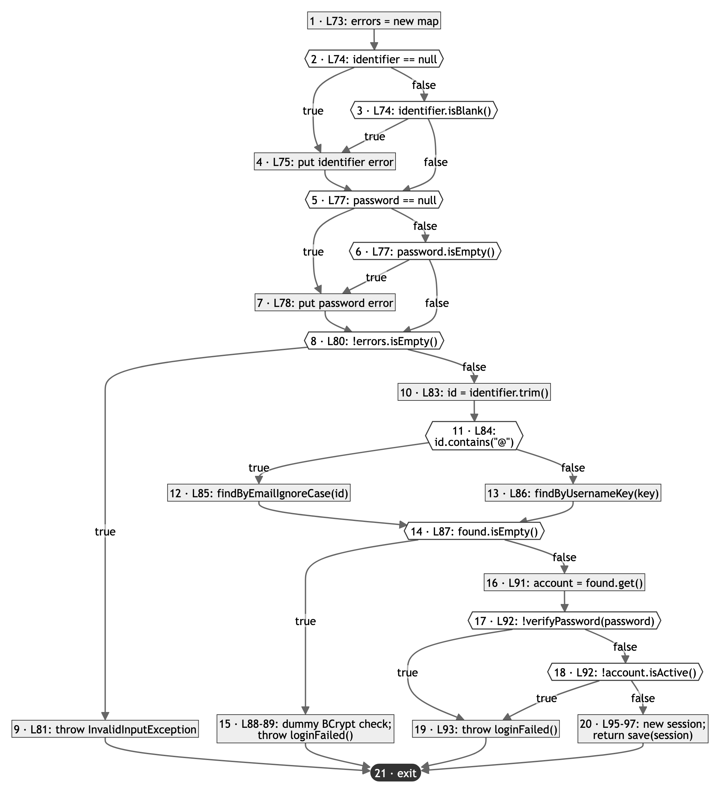

# Basis path testing of `AuthController.login`

| Item | Value |
|:--:|:--:|
| Lab 4 section | 3.2.2 (basis path testing) and its part of 3.2.3 (minimising the test cases) |
| Date | 6 Nov 2026 |
| Author | Lingyi Liu |
| Code version | branch `test/lab4-testing`, based on commit `856c52f` |
| Method under test | `AuthController.login(String identifier, String password)`, lines 72–98 of `src/main/java/sg/schoolmatch/control/AuthController.java` |
| Use case | Log In (FR-LOGIN-01 to FR-LOGIN-05) |
| Method source | Lecture 19–20 (basis path testing), slides 21–33 |
| JUnit class | `src/test/java/sg/schoolmatch/control/AuthControllerBasisPathTest.java` |
| Test case ids | TC-BP-LOGIN-01 to TC-BP-LOGIN-10 |
| Results | see `test-results.md` (built from the run; file `target/test-results/basis-path-login.csv`) |

## 1. Why this method

`login` decides who gets into the system. It checks two input fields, picks one of two account lookups, and then
rejects three kinds of bad credentials with one shared message. It has nine simple conditions in 27 lines, so a
mistake on one branch is easy to miss with ordinary tests.

## 2. What the specification says

The expected session or error of every test case comes from the sources in Table 1, not from the code.

**Table 1. Specification of `login` used for the expected outputs**

| Source | What `login` must do |
|:--:|:--:|
| FR-LOGIN-01; Javadoc of `login` | Accept a username or an email. An identifier that contains `@` is looked up as an email (`findByEmailIgnoreCase`); any other identifier is looked up as a username. |
| DC-70 | A username is looked up by its key: trimmed and lower-cased (`Account.usernameKey`, `findByUsernameKey`). |
| FR-LOGIN-02; use case Log In, step 5 and AF-1 | Both fields are required. A missing identifier gives the field error `identifier` = "Enter your username or email" (`AuthController.IDENTIFIER_MISSING_MESSAGE`). A missing password gives `password` = "Enter your password" (`AuthController.PASSWORD_MISSING_MESSAGE`). All missing fields are reported together. The credentials are not checked (step 6) until step 5 passes, so no account lookup happens. |
| FR-LOGIN-03; NFR-SEC-02 | The password is checked against the stored BCrypt hash of the account (`Account.verifyPassword`). |
| FR-LOGIN-04; use case special requirement | On success, one authenticated session is created and saved. It expires after the idle timeout: `app.session.idle-timeout: 30m` in `application.yml`. |
| FR-LOGIN-05; DC-46; use case precondition "registered and active account" | An unknown user, a wrong password and an `INACTIVE` account all give the same single error: key `login` (`AuthController.LOGIN_ERROR`) with "Incorrect username/email or password" (`AuthController.LOGIN_FAILED_MESSAGE`). No session is created. |

DC-46 and DC-70 are recorded in `docs/design-changes.md`, and the tests use them as the specification.

## 3. Code under test

```java
 72  public AuthenticatedSession login(String identifier, String password) {
 73      Map<String, String> errors = new LinkedHashMap<>();
 74      if (identifier == null || identifier.isBlank()) {
 75          errors.put("identifier", IDENTIFIER_MISSING_MESSAGE);
 76      }
 77      if (password == null || password.isEmpty()) {
 78          errors.put("password", PASSWORD_MISSING_MESSAGE);
 79      }
 80      if (!errors.isEmpty()) {
 81          throw new InvalidInputException(errors);
 82      }
 83      String id = identifier.trim();
 84      Optional<Account> found = id.contains("@")
 85              ? accountRepository.findByEmailIgnoreCase(id)
 86              : accountRepository.findByUsernameKey(Account.usernameKey(id));   // DC-70
 87      if (found.isEmpty()) {
 88          DUMMY_ENCODER.matches(password, DUMMY_HASH);   // takes as long as checking a real password
 89          throw loginFailed();
 90      }
 91      Account account = found.get();
 92      if (!account.verifyPassword(password) || !account.isActive()) {
 93          throw loginFailed();
 94      }
 95      Instant now = clock.instant();
 96      AuthenticatedSession session = new AuthenticatedSession(newSessionId(), account, now, now.plus(idleTimeout()));
 97      return sessionRepository.save(session);
 98  }
```

## 4. Control flow graph

`README.md` section 1 defines the terms. We drew Figure 1 with these rules:

- A node is either one simple condition or a run of statements with no decision between them (Lecture 19–20, slide 26:
  the statements `q = 1; x = 2;` form one node and the test `if a > 0` is the next).
- We split each `a || b` into one decision node per condition. `b` runs only when `a` is false, so the compiler emits
  one conditional jump for each (Table 3). Lines 74, 77 and 92 each give two decision nodes.
- Lecture 19–20, slide 24, describes decision points as `if`, `while`, `for` and `switch` statements. Counted that
  way, `login` has 6 decision points (five `if` statements and the `?:`) and V(G) = 7. We count each simple condition
  instead, because only then do a null and a blank identifier, a null and an empty password, and a wrong password (P8)
  and an `INACTIVE` account (P9) get separate paths.
- The `?:` on lines 84–86 is one decision (node 11). Its two branches meet again at node 14.
- Each method call stays one step. The repository calls on lines 85 and 86 are statement nodes.
  A call inside a condition (`isBlank`, `isEmpty`, `contains`, `verifyPassword`, `isActive`) is part of that decision
  node. The `&&` inside `Account.verifyPassword` belongs to the graph of `verifyPassword`, not of `login`.
- Every `throw` and the `return` go to the single exit node 21.
- We do not draw exceptions thrown inside a called method (for example, the database is down: use case EX-1), because
  they are not branches of `login`.



**Figure 1. Control flow graph of `AuthController.login`** (source `figures/cfg-login.mmd`). Hexagons are decision nodes, rectangles are statement nodes, and the dark rounded node is the exit. Each edge out of
a decision is labelled with its outcome. No two edges cross.

**Table 2. Nodes of the graph**

| Node | Lines | Kind | Code | Next node |
|:--:|:--:|:--:|:--:|:--:|
| 1 | 73 | statement | `errors = new LinkedHashMap<>()` | 2 |
| 2 | 74 | decision | `identifier == null` | true → 4, false → 3 |
| 3 | 74 | decision | `identifier.isBlank()` | true → 4, false → 5 |
| 4 | 75 | statement | `errors.put("identifier", IDENTIFIER_MISSING_MESSAGE)` | 5 |
| 5 | 77 | decision | `password == null` | true → 7, false → 6 |
| 6 | 77 | decision | `password.isEmpty()` | true → 7, false → 8 |
| 7 | 78 | statement | `errors.put("password", PASSWORD_MISSING_MESSAGE)` | 8 |
| 8 | 80 | decision | `!errors.isEmpty()` | true → 9, false → 10 |
| 9 | 81 | statement | `throw new InvalidInputException(errors)` | 21 |
| 10 | 83 | statement | `id = identifier.trim()` | 11 |
| 11 | 84 | decision | `id.contains("@")` | true → 12, false → 13 |
| 12 | 85 | statement | `found = accountRepository.findByEmailIgnoreCase(id)` | 14 |
| 13 | 86 | statement | `found = accountRepository.findByUsernameKey(Account.usernameKey(id))` | 14 |
| 14 | 87 | decision | `found.isEmpty()` | true → 15, false → 16 |
| 15 | 88–89 | statement | `DUMMY_ENCODER.matches(password, DUMMY_HASH); throw loginFailed()` | 21 |
| 16 | 91 | statement | `account = found.get()` | 17 |
| 17 | 92 | decision | `!account.verifyPassword(password)` | true → 19, false → 18 |
| 18 | 92 | decision | `!account.isActive()` | true → 19, false → 20 |
| 19 | 93 | statement | `throw loginFailed()` | 21 |
| 20 | 95–97 | statement | `now = clock.instant()`; `session = new AuthenticatedSession(...)`; `return sessionRepository.save(session)` | 21 |
| 21 | 98 | exit | end of `login` (after a `throw` or the `return`) | – |

The bytecode confirms the nine decision nodes. `javap -c` on the compiled `AuthController` (JDK 21) lists exactly
nine conditional jumps in `login`, one per decision node (Table 3). The only other jump is the `goto` at offset 97,
which ends the email branch of the `?:` and joins node 14.

**Table 3. Decision nodes and their conditional jumps in the bytecode of `login`**

| Node | Condition | Bytecode offset | Instruction |
|:--:|:--:|:--:|:--:|
| 2 | `identifier == null` | 9 | `ifnull` |
| 3 | `identifier.isBlank()` | 16 | `ifeq` |
| 5 | `password == null` | 31 | `ifnull` |
| 6 | `password.isEmpty()` | 38 | `ifeq` |
| 8 | `!errors.isEmpty()` | 58 | `ifne` |
| 11 | `id.contains("@")` | 83 | `ifeq` |
| 14 | `found.isEmpty()` | 121 | `ifeq` |
| 17 | `!account.verifyPassword(password)` | 155 | `ifeq` |
| 18 | `!account.isActive()` | 163 | `ifne` |

## 5. Cyclomatic complexity

We computed V(G) three ways (Lecture 19–20, slides 23–25):

1. **Edges and nodes.** N = 21 nodes (Table 2). E = 29 edges: 9 decision nodes × 2 out-edges = 18, plus 11 statement
   nodes × 1 out-edge = 11 (the exit node has none). V(G) = E − N + 2 = 29 − 21 + 2 = **10**.
2. **Decision nodes.** P = 9 decision nodes, all with two outcomes. V(G) = P + 1 = 9 + 1 = **10**.
3. **Regions.** Figure 1 has no crossing edges, so we can count its regions directly (Table 4): 9 enclosed regions +
   1 outside region = **10**.

**Table 4. Regions of Figure 1**

| Region | Edges around it |
|:--:|:--:|
| R1 | 2→4, 2→3, 3→4 |
| R2 | 3→4, 4→5, 3→5 |
| R3 | 5→7, 5→6, 6→7 |
| R4 | 6→7, 7→8, 6→8 |
| R5 | 8→9, 9→21 on one side; 8→10, 10→11, 11→12, 12→14, 14→15, 15→21 on the other |
| R6 | 11→12, 12→14, 11→13, 13→14 |
| R7 | 14→15, 15→21 on one side; 14→16, 16→17, 17→19, 19→21 on the other |
| R8 | 17→19, 17→18, 18→19 |
| R9 | 18→19, 19→21 on one side; 18→20, 20→21 on the other |
| R10 | the area outside the graph |

The three results agree: **V(G) = 10**. JaCoCo also reports a complexity of 10 for `login` (Section 8).

Merging the statements on lines 73, 83 and 91 into the decision node after each of them gives 18 nodes and 26 edges, so
V(G) = 26 − 18 + 2 = 10 again. We keep them as separate nodes, as in Lecture 19–20, slide 26.

## 6. Basis paths

We followed Lecture 19–20, slides 27–29: take a typical path as the baseline, then change one decision at a time and
keep the others the same where possible. Our baseline P1 is a successful login with a username, the main flow of the
use case.

Two facts about the code decide which paths are feasible:

- Node 8 is true exactly when node 4 or node 7 ran. So a path that changes decision 2, 3, 5 or 6 to true must also
  change decision 8 to true. P2 to P5 change both together. Slide 33 does the same: when one decision forces another,
  it changes both in one path. Changing decision 2 alone and continuing to line 83 with a null identifier is
  infeasible.
- With a missing identifier, the code does not throw at once. It still runs the password checks (node 5, and node 6
  when the password is not null) and throws on line 81 with every error it collected. P2, P3 and P10 follow this.

**Table 5. Basis paths (V(G) = 10), in the order they were derived from the baseline**

| Path | Node sequence | Decisions changed from P1 | Feasible |
|:--:|:--:|:--:|:--:|
| P1 | 1-2-3-5-6-8-10-11-13-14-16-17-18-20-21 | none (baseline: every decision false) | yes |
| P2 | 1-2-4-5-6-8-9-21 | 2 true (forces 8 true) | yes |
| P3 | 1-2-3-4-5-6-8-9-21 | 3 true (forces 8 true) | yes |
| P4 | 1-2-3-5-7-8-9-21 | 5 true (forces 8 true) | yes |
| P5 | 1-2-3-5-6-7-8-9-21 | 6 true (forces 8 true) | yes |
| P6 | 1-2-3-5-6-8-10-11-12-14-16-17-18-20-21 | 11 true | yes |
| P7 | 1-2-3-5-6-8-10-11-13-14-15-21 | 14 true | yes |
| P8 | 1-2-3-5-6-8-10-11-13-14-16-17-19-21 | 17 true (18 is skipped by `\|\|`) | yes |
| P9 | 1-2-3-5-6-8-10-11-13-14-16-17-18-19-21 | 18 true | yes |
| P10 | 1-2-4-5-7-8-9-21 | 2 and 5 true (force 8 true) | yes |

Decision 8 has no change of its own. Changing it alone gives 1-2-3-5-6-8-9-21: no field is missing, yet line 81
throws. That path is infeasible, because `errors` is empty when nodes 4 and 7 did not run. Slide 33 keeps such an
infeasible path in its basis set and leaves it untested. We replace it with the feasible path P10, which changes
decisions 2 and 5 together (both fields null; decision 8 is forced true).

In the order of Table 5, P1 to P9 already use all 29 edges, so P10 adds no new edge. The rule of slide 21 depends on
the order of the list. Table 6 lists the same ten paths in an order where every path adds at least one new edge, so
the ten paths meet the rule. It has to start with P10: with P1 first, at most nine feasible paths can each add a new
edge (we tried every order of the 16 feasible paths of Section 8).

**Table 6. The basis paths in an order in which each path adds a new edge**

| Order | Path | New edges (not used by any path above it) |
|:--:|:--:|:--:|
| 1 | P10 | 1→2, 2→4, 4→5, 5→7, 7→8, 8→9, 9→21 |
| 2 | P4 | 2→3, 3→5 |
| 3 | P2 | 5→6, 6→8 |
| 4 | P1 | 8→10, 10→11, 11→13, 13→14, 14→16, 16→17, 17→18, 18→20, 20→21 |
| 5 | P7 | 14→15, 15→21 |
| 6 | P3 | 3→4 |
| 7 | P8 | 17→19, 19→21 |
| 8 | P9 | 18→19 |
| 9 | P5 | 6→7 |
| 10 | P6 | 11→12, 12→14 |

The new edges add up to 7 + 2 + 2 + 9 + 2 + 1 + 2 + 1 + 1 + 2 = 29, every edge of Figure 1.

A second check does not depend on the order. For any path, let f = (uses of the edges 2→4, 3→4, 5→7 and 6→7) −
(uses of edge 8→9). f = 0 for P1 and P6 to P9 (no missing field, no throw at line 81) and
f = 1 − 1 = 0 for P2 to P5 (one missing field, one throw). Any sum or difference of P1 to P9 therefore also has
f = 0. P10 has f = 2 − 1 = 1, so it cannot be built from P1 to P9.

## 7. Test cases

One test case runs each basis path; TC-BP-LOGIN-nn runs Pnn.

Set-up shared by all ten tests:

- `AccountRepository` and `AuthenticatedSessionRepository` are Mockito mocks. Each test stubs only the lookup its path
  reaches. Every other lookup returns `Optional.empty()`, as the database does for an unknown key.
  `AuthenticatedSessionRepository.save` returns the session it is given.
- The account is `alice_01`, email `alice@example.com`, password `Passw0rd` (stored as a BCrypt hash), status `ACTIVE`
  unless a test sets `INACTIVE`. It is a Mockito spy of a real `Account`, so the real BCrypt check runs and the test
  can record which of `verifyPassword` (node 17) and `isActive` (node 18) were called.
- The clock is `sg.schoolmatch.support.FixedClock` stopped at 2026-10-12T02:00:00Z (10:00 in Singapore). The settings
  are `TestProperties.defaults()`, whose idle timeout is 30 minutes, the same as `app.session.idle-timeout`.

The expected and actual outputs are written in one format, so they can be compared word for word. The output has four
parts:

- the result: a session, shown as `session for <username>, issuedAt=<time>, expiresAt=<time>`, or a rejected login,
  shown as `InvalidInputException` with its field errors;
- `lookups`: every `AccountRepository` call, in order;
- `checks`: the calls of `verifyPassword` and `isActive` on the account, in order;
- `saved`: what `AuthenticatedSessionRepository.save` was given. `returned session` means the session that `login`
  returned.

The result part comes from the specification (Table 1). The `lookups`, `checks` and `saved` parts come from the path
the test case is designed to run (Table 5); they show that the path ran (Table 8). Each test records input, expected
output and actual output with `TestResultLog.record("basis-path-login", ...)` and then makes one assertion: the actual
output equals the expected output. So the recorded row and the JUnit verdict always agree.

**Table 7. Test cases: input and expected output**

| Test case | Path | Requirements | Input | Expected output | JUnit method in `AuthControllerBasisPathTest` |
|:--:|:--:|:--:|:--:|:--:|:--:|
| TC-BP-LOGIN-01 | P1 | FR-LOGIN-01, FR-LOGIN-03, FR-LOGIN-04, DC-70 | identifier `Alice_01`; password `Passw0rd`; `findByUsernameKey("alice_01")` returns `alice_01` (ACTIVE) | `session for alice_01, issuedAt=2026-10-12T02:00:00Z, expiresAt=2026-10-12T02:30:00Z; lookups=[findByUsernameKey(alice_01)]; checks=[verifyPassword(Passw0rd), isActive()]; saved=[returned session]` | `p1_username_rightPassword_active_createsSession` |
| TC-BP-LOGIN-02 | P2 | FR-LOGIN-02 | identifier `null`; password `Passw0rd` | `InvalidInputException {identifier=Enter your username or email}; lookups=[]; checks=[]; saved=[]` | `p2_identifierNull_identifierError` |
| TC-BP-LOGIN-03 | P3 | FR-LOGIN-02 | identifier `"   "` (3 spaces); password `Passw0rd` | `InvalidInputException {identifier=Enter your username or email}; lookups=[]; checks=[]; saved=[]` | `p3_identifierBlank_identifierError` |
| TC-BP-LOGIN-04 | P4 | FR-LOGIN-02 | identifier `Alice_01`; password `null` | `InvalidInputException {password=Enter your password}; lookups=[]; checks=[]; saved=[]` | `p4_passwordNull_passwordError` |
| TC-BP-LOGIN-05 | P5 | FR-LOGIN-02 | identifier `Alice_01`; password `""` (empty) | `InvalidInputException {password=Enter your password}; lookups=[]; checks=[]; saved=[]` | `p5_passwordEmpty_passwordError` |
| TC-BP-LOGIN-06 | P6 | FR-LOGIN-01, FR-LOGIN-04 | identifier `alice@example.com`; password `Passw0rd`; `findByEmailIgnoreCase("alice@example.com")` returns `alice_01` (ACTIVE) | `session for alice_01, issuedAt=2026-10-12T02:00:00Z, expiresAt=2026-10-12T02:30:00Z; lookups=[findByEmailIgnoreCase(alice@example.com)]; checks=[verifyPassword(Passw0rd), isActive()]; saved=[returned session]` | `p6_email_rightPassword_active_createsSession` |
| TC-BP-LOGIN-07 | P7 | FR-LOGIN-05, DC-46, DC-70 | identifier `nobody`; password `Passw0rd`; `findByUsernameKey("nobody")` returns empty | `InvalidInputException {login=Incorrect username/email or password}; lookups=[findByUsernameKey(nobody)]; checks=[]; saved=[]` | `p7_unknownUsername_genericError` |
| TC-BP-LOGIN-08 | P8 | FR-LOGIN-03, FR-LOGIN-05, DC-46, DC-70 | identifier `Alice_01`; password `Passw0rD` (last letter upper case); `findByUsernameKey("alice_01")` returns `alice_01` (ACTIVE) | `InvalidInputException {login=Incorrect username/email or password}; lookups=[findByUsernameKey(alice_01)]; checks=[verifyPassword(Passw0rD)]; saved=[]` | `p8_wrongPassword_genericError` |
| TC-BP-LOGIN-09 | P9 | FR-LOGIN-05, DC-46, DC-70 | identifier `Alice_01`; password `Passw0rd`; `findByUsernameKey("alice_01")` returns `alice_01` with status `INACTIVE` | `InvalidInputException {login=Incorrect username/email or password}; lookups=[findByUsernameKey(alice_01)]; checks=[verifyPassword(Passw0rd), isActive()]; saved=[]` | `p9_inactiveAccount_genericError` |
| TC-BP-LOGIN-10 | P10 | FR-LOGIN-02 | identifier `null`; password `null` | `InvalidInputException {identifier=Enter your username or email, password=Enter your password}; lookups=[]; checks=[]; saved=[]` | `p10_bothNull_bothErrors` |

Every test that gives a username types it as `Alice_01`, with a capital A. This does not change the path, and it
shows that line 86 looks the name up by its lower-case key `alice_01` (DC-70).

**Table 8. How the output of each test shows that its path ran**

| Test case | Evidence in the actual output |
|:--:|:--:|
| TC-BP-LOGIN-01 | `lookups=[findByUsernameKey(alice_01)]` (node 13, not 12); `checks` has both calls (nodes 17 and 18 ran, both false); `saved=[returned session]` (node 20 saved the session that `login` returned) |
| TC-BP-LOGIN-02 | the error map has only the key `identifier` (node 4 ran; nodes 5 and 6 false); `lookups=[]` (node 10 onwards not reached); `saved=[]` |
| TC-BP-LOGIN-03 | the error map has only `identifier` (node 3 true); `lookups=[]`; `saved=[]` |
| TC-BP-LOGIN-04 | the error map has only `password` (node 5 true; nodes 2 and 3 false); `lookups=[]`; `saved=[]` |
| TC-BP-LOGIN-05 | the error map has only `password` (node 6 true); `lookups=[]`; `saved=[]` |
| TC-BP-LOGIN-06 | `lookups=[findByEmailIgnoreCase(alice@example.com)]` and no `findByUsernameKey` (node 12, not 13); `checks` has both calls (nodes 17 and 18 ran); `saved=[returned session]` |
| TC-BP-LOGIN-07 | the generic login error with `lookups=[findByUsernameKey(nobody)]` (node 14 true); reaching node 16 would throw `NoSuchElementException` at `found.get()`, so the result would differ |
| TC-BP-LOGIN-08 | `checks=[verifyPassword(Passw0rD)]` with no `isActive()` (node 17 true; node 18 skipped by short-circuit); `saved=[]` |
| TC-BP-LOGIN-09 | `checks=[verifyPassword(Passw0rd), isActive()]` (node 17 false, node 18 ran and was true); `saved=[]` |
| TC-BP-LOGIN-10 | the error map has both `identifier` and `password` (nodes 4 and 7 both ran); `lookups=[]`; `saved=[]` |

Run the ten tests from the project folder:

```
JAVA_HOME=$(/usr/libexec/java_home -v 21) ./mvnw -B -q -Dtest=AuthControllerBasisPathTest -Dsurefire.failIfNoSpecifiedTests=false test
```

Results: see `test-results.md`.

## 8. Minimising the number of test cases (section 3.2.3)

- **Ten tests instead of every path.** The graph has 81 entry-to-exit paths: 9 ways through nodes 2–7, times 9 ways
  from node 8 to the exit (1 through node 9, 8 through nodes 10–20). Only 16 of them are feasible, because node 8 is
  true exactly when node 4 or node 7 ran: 8 paths stop at line 81 (at least one field missing) and 8 reach line 84
  (2 lookups × 4 endings). The basis set needs 10 of these 16. Testing every feasible path would take 6 more tests,
  and those 6 would use no edge that the 10 do not already use.
- **One test per basis path, and no more.** TC-BP-LOGIN-02 to 09 each change one thing from the baseline
  TC-BP-LOGIN-01: the field or the account state that drives the decision being changed. TC-BP-LOGIN-10 changes both
  fields, as its path needs. The same account, password and clock serve all ten tests.
- **Simple inputs.** Each input is a simple value that forces its path: `null` for a field that was not sent, three
  spaces for a blank identifier, `""` for an empty password, `nobody` for an unknown user, one changed letter for a
  wrong password, and status `INACTIVE` for a closed account.
- **Why we keep TC-BP-LOGIN-10.** TC-BP-LOGIN-01 to 09 already run all 29 edges and all 18 branches. We keep it
  because basis path testing needs V(G) = 10 independent paths (Lecture 19–20, slides 23–25), and the only other
  choice for the tenth path, decision 8 changed on its own, is infeasible. It is also the only case with two missing
  fields, so it is the only one that checks that all missing fields are reported together (use case Log In, AF-1).
- **Coverage reached.** The ten tests run every node and every edge of Figure 1. JaCoCo 0.8.16, run on this test
  class alone on 6 Nov 2026, reports for `login`: 20 of 20 lines, 94 of 94 bytecode instructions, 18 of 18
  branches, and complexity 10. Command:
  `./mvnw -B org.jacoco:jacoco-maven-plugin:0.8.16:prepare-agent test org.jacoco:jacoco-maven-plugin:0.8.16:report -Dtest=AuthControllerBasisPathTest -Dsurefire.failIfNoSpecifiedTests=false`
  (report in `target/site/jacoco/`).
- **What is left to black-box tests.** Inputs that do not change the path inside `login`, such as a password longer
  than 72 bytes or an email typed in another case, are covered by the black-box test cases in
  `src/test/resources/testcases/TC-LOGIN.csv`, not here.
