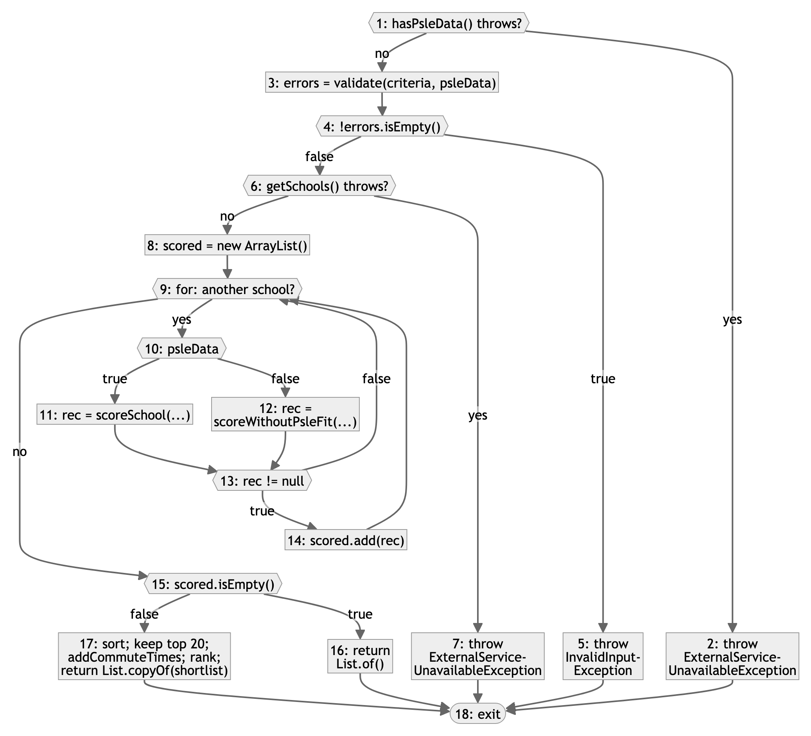

# Basis path testing of `RecommendationController.recommend`

| Item | Value |
|:--:|:--:|
| Lab 4 section | 3.2.2 (basis path testing) and its part of 3.2.3 (fewest test cases) |
| Date | 6 Nov 2026 |
| Author | Lingyi Liu |
| Code version | branch `test/lab4-testing`, based on commit `856c52f` |
| Method under test | `RecommendationController.recommend(MatchCriteria)` in `src/main/java/sg/schoolmatch/control/RecommendationController.java`, lines 85–123 |
| Test class | `src/test/java/sg/schoolmatch/control/RecommendationControllerBasisPathTest.java` (JUnit 5, Mockito) |
| Test cases | `TC-BP-REC-01` to `TC-BP-REC-08` |
| Results | see `test-results.md` |

## 1. The method and why we chose it

`recommend` turns a student's criteria into at most 10 ranked schools. It implements use case #06 Get School Recommendations and requirement FR-REC-01. The method:

1. asks `SchoolDataController.hasPsleData()` whether the dataset has PSLE score ranges (DC-74);
2. checks the criteria with `validate` and throws `InvalidInputException` with one message per wrong field (use case EX-1);
3. reads the schools with `SchoolDataController.getSchools()`; a failure in step 1 or step 3 becomes `ExternalServiceUnavailableException` (EX-3);
4. scores each school with `scoreSchool` when the dataset has PSLE ranges, or with `scoreWithoutPsleFit` when it has none, and keeps the schools that are candidates;
5. returns an empty list when no school is kept (EX-2);
6. otherwise pre-ranks the schools, gets travel times for the best 20 in one `DirectionsController.getCommuteTimes` call (`addCommuteTimes`), ranks them and returns the top 10 (`rank`).

We chose it because it has seven decisions, three exception exits and a loop, and it ties together the school data, the scoring rules and the route service. The rules come from `docs/recommendation-scoring.md` section 5, DC-20 (SAFE, MATCH and REACH), DC-22 (which PSLE range applies), DC-53 (the `app.recommendation.*` settings) and DC-74 (a dataset without PSLE ranges).

## 2. Terms

`README.md` section 1 defines the terms.

## 3. Control flow graph

### 3.1 Conventions

- We draw one graph per method. A call to another method is one statement node. This covers `validate`, `scoreSchool`, `scoreWithoutPsleFit`, `addCommuteTimes`, `rank` and the comparator lambdas passed to `sort`, so their own branches, such as the `?:` inside the second lambda at lines 115–116, do not appear here.
- A `try` whose call can throw is one decision, "throws?". "Yes" goes to the `catch` block; "no" goes on. The lecture lists `if`, `while`, `for` and `switch` as decision points. We count the `try` too, because its `catch` is a second way out of the call, with its own exit (EX-3), which a test must reach.
- `recommend` has no `&&` or `||` of its own. Those in `validate` belong to `validate`. The rule for compound conditions is in `basis-path-login.md`.
- The `for` loop is one decision: enter the body for the next school, or leave the loop.
- The ternary `psleData ? scoreSchool(...) : scoreWithoutPsleFit(...)` is one decision, with one statement node per branch.
- A statement just before a decision is its own node, as in the lecture's `computeP` example (`p = q/x;` and `if b==3` are two nodes).
- Every `return` and every `throw` goes to the single exit node 18.
- A declaration without code (`boolean psleData;`, `List<School> schools;`) belongs to the next node.

### 3.2 Nodes and edges

**Table 1. Nodes of the control flow graph of `recommend`.**

| Node | Kind | Lines | Code |
|:--:|:--:|:--:|:--:|
| 1 | decision | 86–88 | `psleData = schoolDataController.hasPsleData()`: throws? |
| 2 | statement | 89–90 | `throw new ExternalServiceUnavailableException("School data", e)` |
| 3 | statement | 92 | `errors = validate(criteria, psleData)` |
| 4 | decision | 93 | `!errors.isEmpty()` |
| 5 | statement | 94 | `throw new InvalidInputException(errors)` |
| 6 | decision | 96–98 | `schools = schoolDataController.getSchools()`: throws? |
| 7 | statement | 99–100 | `throw new ExternalServiceUnavailableException("School data", e)` |
| 8 | statement | 103 | `scored = new ArrayList<>()` |
| 9 | decision | 104 | `for (School school : schools)`: another school? |
| 10 | decision | 105 | `psleData ? … : …` |
| 11 | statement | 105 | `rec = scoreSchool(school, criteria)` |
| 12 | statement | 105 | `rec = scoreWithoutPsleFit(school, criteria)` |
| 13 | decision | 106 | `rec != null` |
| 14 | statement | 107 | `scored.add(rec)` |
| 15 | decision | 110 | `scored.isEmpty()` |
| 16 | statement | 111 | `return List.of()` |
| 17 | statement | 113–122 | `start = …`; `scored.sort(…)`; `shortlist` = the first `commuteCandidates` (20); `addCommuteTimes(shortlist, criteria, psleData)`; `rank(shortlist)`; `return List.copyOf(shortlist)` |
| 18 | exit | 123 | end of the method |



**Figure 1. Control flow graph of `recommend` (source `figures/cfg-recommend.mmd`). Hexagons are decision nodes. Each edge out of a decision is labelled with its outcome. No two edges cross.**

**Table 2. The 24 edges. The first word of each outcome is the edge label in Figure 1.**

| Edge | From → to | Outcome | Edge | From → to | Outcome |
|:--:|:--:|:--:|:--:|:--:|:--:|
| e1 | 1 → 2 | yes (throws) | e13 | 9 → 15 | no (no more schools) |
| e2 | 1 → 3 | no (returns) | e14 | 10 → 11 | true |
| e3 | 2 → 18 | – | e15 | 10 → 12 | false |
| e4 | 3 → 4 | – | e16 | 11 → 13 | – |
| e5 | 4 → 5 | true | e17 | 12 → 13 | – |
| e6 | 4 → 6 | false | e18 | 13 → 14 | true |
| e7 | 5 → 18 | – | e19 | 13 → 9 | false |
| e8 | 6 → 7 | yes (throws) | e20 | 14 → 9 | – |
| e9 | 6 → 8 | no (returns) | e21 | 15 → 16 | true |
| e10 | 7 → 18 | – | e22 | 15 → 17 | false |
| e11 | 8 → 9 | – | e23 | 16 → 18 | – |
| e12 | 9 → 10 | yes (another school) | e24 | 17 → 18 | – |

## 4. Cyclomatic complexity

**Table 3. V(G) of `recommend`, computed three ways.**

| Formula | Count | V(G) |
|:--:|:--:|:--:|
| V(G) = E − N + 2 | E = 24 edges (Table 2), N = 18 nodes (Table 1) | 24 − 18 + 2 = **8** |
| V(G) = P + 1 | P = 7 decision nodes: 1, 4, 6, 9, 10, 13, 15; each has exactly two outcomes | 7 + 1 = **8** |
| V(G) = number of regions | 7 enclosed regions in Figure 1 (Table 4) + 1 outer region | 7 + 1 = **8** |

**Table 4. Regions of Figure 1.**

| Region | Nodes on its border | Enclosed by |
|:--:|:--:|:--:|
| R1 | 1, 2, 18, 5, 4, 3 | the two branches of node 1 |
| R2 | 4, 5, 18, 7, 6 | the two branches of node 4 |
| R3 | 6, 7, 18, 16, 15, 9, 8 (the loop body is drawn inside it, attached at node 9) | the two branches of node 6 |
| R4 | 15, 16, 18, 17 | the two branches of node 15 |
| R5 | 10, 11, 13, 12 | the two branches of node 10 |
| R6 | 9, 10, 12, 13 | the path 9 → 10 → 12 → 13 and the loop's back edge 13 → 9 |
| R7 | 13, 14, 9 | the two branches of node 13 (13 → 14 → 9 and 13 → 9) |
| R8 | the area outside the graph | – |

The three results agree: V(G) = 8.

Counting only `if`, `for` and `?:` as decision points, as slide 24 lists them, gives P = 5 (nodes 4, 9, 10, 13 and 15) and V(G) = 6. JaCoCo reports the same 6 (section 7). The two `try`/`catch` decisions (nodes 1 and 6) add the paths P2 and P4, which test the exit EX-3 (section 3.1).

Merging statement nodes does not change the result. If node 3 is merged into node 4 and node 8 into node 9, the graph has 16 nodes and 22 edges, and V(G) = 22 − 16 + 2 = 8 is unchanged. A statement node on a straight line adds one node and one edge, so it never changes V(G).

## 5. Basis paths

We built P1 to P7 with the rules of Lecture 19–20:

1. Slide 34: run each loop only zero times or once, and take the loop's false branch first in the baseline. So our baseline does not enter the loop. Apart from that, it is the normal flow: valid criteria and no failure.
2. Then we flip one decision at a time, in node order, and keep the other decisions as they were where possible.
3. When a flip forces a second decision to change, we change both in one path (slide 33).
4. The lecture keeps an infeasible basis path in the set with no test case (slides 23 and 32–33). For the eighth path we do something different. "The eighth path" below explains why.

**Table 5. Basis set of `recommend`. A node sequence lists the nodes in the order they run.**

| Path | Node sequence | Built from | New edges | Feasible? |
|:--:|:--:|:--:|:--:|:--:|
| P1 | 1-3-4-6-8-9-15-16-18 | baseline | e2, e4, e6, e9, e11, e13, e21, e23 | yes: `getSchools()` returns an empty list |
| P2 | 1-2-18 | P1, flip node 1 | e1, e3 | yes: `hasPsleData()` throws |
| P3 | 1-3-4-5-18 | P1, flip node 4 | e5, e7 | yes: one field is invalid |
| P4 | 1-3-4-6-7-18 | P1, flip node 6 | e8, e10 | yes: `getSchools()` throws |
| P5 | 1-3-4-6-8-9-10-11-13-9-15-16-18 | P1, flip node 9 (node 10 true and node 13 false, so node 15 stays true) | e12, e14, e16, e19 | yes: one school that is not a candidate |
| P6 | 1-3-4-6-8-9-10-11-13-14-9-15-17-18 | P5, flip node 13; node 15 flips with it | e18, e20, e22, e24 | yes: one candidate school |
| P7 | 1-3-4-6-8-9-10-12-13-14-9-15-17-18 | P6, flip node 10 | e15, e17 | yes: no PSLE ranges in the dataset |
| P8 | 1-3-4-6-8-9-10-11-13-14-9-10-11-13-14-9-15-17-18 | P6, the loop runs a second time (replaces the infeasible flip of node 15; see below) | none; independent by the check below | yes: two candidate schools |

Three single flips are infeasible. This is how we handled each one.

- **Node 13 from P5.** Flipping only node 13 gives 1-…-13-14-9-15-16-18. Node 14 adds a school to `scored`, so node 15 (`scored.isEmpty()`) must then be false. P6 changes node 13 and node 15 together. It adds four new edges.
- **Node 10 from P5.** Flipping node 10 on P5 gives 1-…-9-10-12-13-9-15-16-18. `scoreWithoutPsleFit` (lines 180–185) always returns a new `Recommendation` and never `null`, so after node 12, node 13 is always true. P7 therefore flips node 10 on P6, where node 13 is already true. It adds e15 and e17.
- **Node 15 alone.** `scored` is empty exactly when no pass through the loop took edge e18 (13 → 14). From P1 (loop not entered) or P5 (the only school dropped), node 15 must be true. From P6 or P7, it must be false. The flip from P1 is 1-3-4-6-8-9-15-17-18.

**The eighth path.** P1 to P7 already use all 24 edges (Table 5, column "New edges"), so no eighth path can add a new edge in this order. But V(G) = 8 means we need one more independent path. To check independence, take (uses of e18, 13 → 14) minus (uses of e22, 15 → 17). This value is 0 for P1 to P7: P1 to P5 use neither edge, and P6 and P7 use each edge once. Adding or subtracting paths keeps it at 0, so a path whose value is not 0 is independent of P1 to P7.

- Under the lecture's rules, the eighth path is the infeasible flip of node 15 on P1: 1-3-4-6-8-9-15-17-18. Its value is 0 − 1 = −1, so it is independent of P1 to P7. Listed before P6, it also adds the new edges e22 and e24, and P6 and P7 still add e18, e20 and e15, e17. The lecture would keep it with no test case (slides 32–33).
- Every feasible path that runs the loop zero times or once is already one of P1 to P7. So a feasible eighth path must run the loop at least twice.
- We use P8 instead, so that all 8 basis paths have a test case. P8 runs the loop twice and keeps both schools. It uses e18 twice and e22 once, so its value is 2 − 1 = 1, and P1 to P8 are 8 independent paths. This breaks the slide 34 loop rule on purpose. It is also the only path where `scored` holds two schools, so its test also checks the pre-ranking, the single route call and the final ranking.

## 6. Test cases

### 6.1 Set-up shared by all test cases

- `SchoolDataController`, `DirectionsController` and `LocationController` are Mockito mocks. `recommend` never calls `LocationController`, because the start location arrives resolved (DC-53).
- `AppProperties` has its default settings (`TestProperties.defaults()`), the same values as `application.yml`. The weights are `PSLE_FIT` 0.4, `COMMUTE` 0.3, `CCA` 0.15 and `PROGRAMME` 0.15. The PSLE fit scores are MATCH 1.0, SAFE 0.7 and near REACH 0.3. `reach-near-margin` is 2, `commute-candidates` is 20 and `top-n` is 10.
- **Baseline criteria**, used unless Table 6 says otherwise: `psleScore` 11, `postingGroup` 3, `travelMode` `TRANSIT`, `maxCommuteMin` 30 (one of `TransportationFilter.DURATION_OPTIONS_MIN`), and `startLocation` Bishan (resolved). There are no preferred CCAs or programmes and no weights of their own, so the settings apply.
- `hasPsleData()` returns true unless Table 6 says otherwise.
- `getCommuteTimes` answers from a map of travel times by school code. A school that is not in the map gets "no route". 15 minutes is 900 seconds.
- The schools are built with `TestSchools`. Both `alpha` and `beta` are located at Bishan.

### 6.2 Expected values

- **Labels (DC-20).** With U = the upper score of the range and m = `SchoolChoice.SAFE_MARGIN` = 2, a score is SAFE if score ≤ U − m and MATCH if U − m < score ≤ U.
- **`alpha` with range PG3 2025 8–12.** U = 12, so 10 < 11 ≤ 12 is MATCH (1.0). COMMUTE = 1 − min(15 / 30, 1) = 0.5. The student gave no CCA or programme preference, so those factors drop out. Total = (0.4 × 1.0 + 0.3 × 0.5) ÷ (0.4 + 0.3) = 0.55 ÷ 0.7 = 0.786.
- **`beta` with range PG3 2025 8–14.** U = 14, so 11 ≤ 14 − 2 = 12 is SAFE (0.7). Total = (0.4 × 0.7 + 0.3 × 0.5) ÷ 0.7 = 0.43 ÷ 0.7 = 0.614.
- **No PSLE data (DC-74).** `PSLE_FIT` has weight 0 and its reason is "PSLE fit not used: no score ranges in the current dataset" (`RecommendationController.PSLE_FIT_NOT_USED`). Total = 0.3 × 0.5 ÷ 0.3 = 0.500.
- **Order (`docs/recommendation-scoring.md` section 5, steps 2–4).** Schools are pre-ranked by PSLE fit, CCA and programme. The top 20 get travel times in one call. The result is sorted best first with ranks 1..n. In P8 the dataset lists `beta` first, so `alpha` ranked first shows that the controller sorted the list.

### 6.3 Test cases

Each expected output gives the result that the specification predicts, then the calls that the path predicts. The expected output in Table 6 is exactly the string the test records and compares.

- `getSchools 1x` means node 6 ran.
- `getCommuteTimes 1x: [alpha, beta] from Bishan by TRANSIT` means node 17 ran and asked for travel times once, for these schools in this order, from the student's start and by the student's mode. `getCommuteTimes 0x` means node 17 did not run.
- In P5 and P7, `alpha` is a Mockito spy. `alpha.getScoreRange(3, false) 1x` means node 11 (`scoreSchool`) ran and asked for the PG3 non-affiliated range once. `alpha.getScoreRange 0x` means node 11 did not run.
- For an `ExternalServiceUnavailableException`, the output gives the service, the message and the cause. `cause = stubbed IllegalStateException` means the cause is the same error object that the stub threw.
- `MATCH 1.0` is the DC-20 label found in the `PSLE_FIT` reason, then the factor score.

**Table 6. Basis path test cases for `recommend`. The class is `RecommendationControllerBasisPathTest`.**

| Test case | Path | Requirements | Input (change from the baseline) | Expected output | JUnit method |
|:--:|:--:|:--:|:--:|:--:|:--:|
| TC-BP-REC-01 | P1 | FR-REC-01 | `getSchools()` returns `[]` | `0 results; getSchools 1x; getCommuteTimes 0x` | `p1_baseline_noSchool_emptyList` |
| TC-BP-REC-02 | P2 | FR-REC-01, NFR-USE-03 | `hasPsleData()` throws `IllegalStateException` | `ExternalServiceUnavailableException (School data): "School data is temporarily unavailable", cause = stubbed IllegalStateException; getSchools 0x; getCommuteTimes 0x` | `p2_psleDataCheckFails_serviceUnavailable` |
| TC-BP-REC-03 | P3 | FR-REC-01, NFR-USE-03 | `psleScore` 33 (`IndicativePsleScoreRange.MAX_SCORE` + 1) | `InvalidInputException {psleScore=Enter a whole number from 4 to 32}; getSchools 0x; getCommuteTimes 0x` | `p3_invalidCriteria_fieldError` |
| TC-BP-REC-04 | P4 | FR-REC-01, NFR-USE-03 | `getSchools()` throws `IllegalStateException` | `ExternalServiceUnavailableException (School data): "School data is temporarily unavailable", cause = stubbed IllegalStateException; getSchools 1x; getCommuteTimes 0x` | `p4_schoolListFails_serviceUnavailable` |
| TC-BP-REC-05 | P5 | FR-REC-01 | schools `[alpha]`; `alpha` has no PSLE range, like the 8 specialised schools; travel 15 min | `0 results; getSchools 1x; getCommuteTimes 0x; alpha.getScoreRange(3, false) 1x` | `p5_loopOnce_schoolWithoutRange_dropped` |
| TC-BP-REC-06 | P6 | FR-REC-01 | schools `[alpha]`; `alpha` has range PG3 2025 8–12; travel 15 min | `1 result: #1 alpha MATCH 1.0, 15 min, total 0.786; getSchools 1x; getCommuteTimes 1x: [alpha] from Bishan by TRANSIT` | `p6_loopOnce_schoolKept_ranked` |
| TC-BP-REC-07 | P7 | FR-REC-01, DC-74 | `hasPsleData()` returns false; schools `[alpha]`; `alpha` has no PSLE range; travel 15 min | `1 result: #1 alpha PSLE fit not used, 15 min, total 0.500; getSchools 1x; getCommuteTimes 1x: [alpha] from Bishan by TRANSIT; alpha.getScoreRange 0x` | `p7_loopOnce_noPsleData_scoredWithoutPsleFit` |
| TC-BP-REC-08 | P8 | FR-REC-01 | schools `[beta, alpha]`; `beta` has range PG3 2025 8–14 and `alpha` 8–12; travel 15 min each | `2 results: #1 alpha MATCH 1.0, 15 min, total 0.786 / #2 beta SAFE 0.7, 15 min, total 0.614; getSchools 1x; getCommuteTimes 1x: [alpha, beta] from Bishan by TRANSIT` | `p8_loopTwice_bothKept_rankedBestFirst` |

**Table 7. Where each expected output comes from, and how each test shows that its path ran.**

| Test case | Specification source | Evidence of the path |
|:--:|:--:|:--:|
| TC-BP-REC-01 | Javadoc of `recommend` ("Empty when no school fits"); use case #06 EX-2 | empty list returned at node 16; no route call, so node 17 did not run |
| TC-BP-REC-02 | `@throws ExternalServiceUnavailableException` of `recommend`; EX-3; NFR-USE-03 and the Javadoc of `ExternalServiceUnavailableException` ("temporarily unavailable") | `getSchools` never called (TC-BP-REC-04 calls it once); the stub's own error is the cause |
| TC-BP-REC-03 | EX-1; NFR-USE-03; `InputMessages.PSLE`; `IndicativePsleScoreRange.MAX_SCORE` = 32 | exactly one field error; `getSchools` never called, so node 6 did not run |
| TC-BP-REC-04 | `@throws ExternalServiceUnavailableException`; EX-3; NFR-USE-03 | `getSchools` called once, then the exception, with the stub's own error as the cause; no route call |
| TC-BP-REC-05 | `docs/recommendation-scoring.md` sections 1 and 5 (a candidate needs a range for the posting group; a guest gets the non-affiliated range; no range is never guessed); DC-22; EX-2 | `alpha.getScoreRange(3, false)` called once (node 11 ran and returned `null`); empty list; no route call |
| TC-BP-REC-06 | DC-20; `recommendation-scoring.md` section 5, scoring table and total; `app.recommendation.*` | `MATCH 1.0` can only come from `scoreSchool` (node 11), because `scoreWithoutPsleFit` gives "PSLE fit not used"; one route call for `[alpha]` (node 17) |
| TC-BP-REC-07 | DC-74; `recommendation-scoring.md` section 5, "No ranges in the dataset" | reason equals `PSLE_FIT_NOT_USED` (node 12, `scoreWithoutPsleFit`); `getScoreRange` never called (node 11 did not run) |
| TC-BP-REC-08 | DC-20; `recommendation-scoring.md` section 5, steps 2–4; FR-REC-01 (ranked list) | two results, so node 14 ran twice; one route call for `[alpha, beta]`: the dataset lists `beta` first, so this order shows the pre-ranking (1.0 before 0.7) |

Each test records its input, expected output and actual output with `TestResultLog.record("basis-path-recommend", …)`, then asserts only that the actual string equals the expected string. So everything a test checks appears in the recorded row in `target/test-results/basis-path-recommend.csv`. Results: see `test-results.md`.

## 7. Fewest test cases (section 3.2.3, basis path part)

- We need 8 test cases, one per basis path, because V(G) = 8 and fewer cases cannot run 8 independent paths. Under the lecture's rules one path would be infeasible and leave 7 cases. We replaced it with the feasible P8 (section 5), the only case in which two schools are ranked against each other.
- Each case changes as little as possible from the case of the path it was built from (Table 5, column "Built from"): P2 and P4 change one stub, P3 one field, P5 adds one school, P6 gives it a range, and P8 adds a second school. P7 turns PSLE data off and removes `alpha`'s range, because no school has a range when `hasPsleData()` is false (DC-74). When a test fails, the cause is one decision.
- A call is one node, so the branches inside `validate`, `scoreSchool`, `addCommuteTimes` and `rank` do not multiply the paths of `recommend`. Those rules are tested by the black-box cases of section 3.2.1 (`black-box-recommendation.md`).
- Some black-box cases already run a basis path of `recommend` (Table 8). We still keep one basis path case per path, because a black-box case checks only the result, and the result does not always show which path ran. P2 and P4 both end with `ExternalServiceUnavailableException`; only the call counts of TC-BP-REC-02 and -04 (`getSchools 0x` against `getSchools 1x`) show which `try` failed.
- We picked input values that make the expected output easy to work out by hand: 15 minutes out of 30 gives a COMMUTE score of 0.5, and the score 11 with ranges 8–12 and 8–14 gives one MATCH and one SAFE.
- JaCoCo 0.8.16, run on `RecommendationControllerBasisPathTest` alone, shows `recommend` fully covered: 28 of 28 lines, 113 of 113 bytecode instructions and 10 of 10 branches. It counts five two-way decisions (lines 93, 104, 105, 106 and 110) and reports a complexity of 6. The two `try`/`catch` decisions bring it to 8, as in section 4.

**Table 8. Black-box cases that run the same path as a basis path case.**

| Path | Basis path case | Black-box case on the same path | What only the basis path case shows |
|:--:|:--:|:--:|:--:|
| P1 | TC-BP-REC-01 | none: no black-box case has an empty school list | – |
| P2 | TC-BP-REC-02 | TC-BB-REC-29 | `getSchools 0x`, and the cause is the stub's own error |
| P3 | TC-BP-REC-03 | TC-BB-REC-11 to -28 and -32, for example TC-BB-REC-12 with the same input | `getSchools 0x`: node 6 did not run |
| P4 | TC-BP-REC-04 | TC-BB-REC-30 | `getSchools 1x`, and the cause is the stub's own error |
| P5 | TC-BP-REC-05 | none: every valid black-box case has at least two schools, so none runs the loop exactly once | – |
| P6 | TC-BP-REC-06 | none: every valid black-box case has at least two schools, so none runs the loop exactly once | – |
| P7 | TC-BP-REC-07 | none: TC-BB-REC-07 runs the loop three times | – |
| P8 | TC-BP-REC-08 | TC-BB-REC-06 (two schools, both kept, route service down) | the route call `[alpha, beta]`, which shows the pre-ranking |

## 8. How to run

From the project root:

```
JAVA_HOME=$(/usr/libexec/java_home -v 21) ./mvnw -B -q -Dtest=RecommendationControllerBasisPathTest -Dsurefire.failIfNoSpecifiedTests=false test
```

The coverage check runs the same tests with the JaCoCo plugin. JaCoCo is not part of the `pom.xml`. The report is `target/site/jacoco/index.html`:

```
JAVA_HOME=$(/usr/libexec/java_home -v 21) ./mvnw -B -q org.jacoco:jacoco-maven-plugin:0.8.16:prepare-agent test org.jacoco:jacoco-maven-plugin:0.8.16:report -Dtest=RecommendationControllerBasisPathTest -Dsurefire.failIfNoSpecifiedTests=false
```
